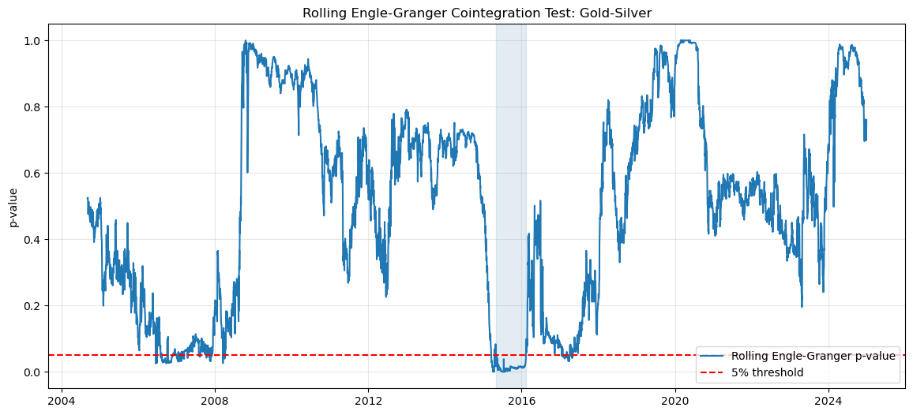
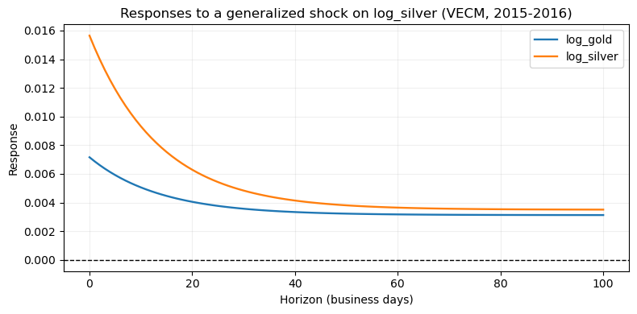
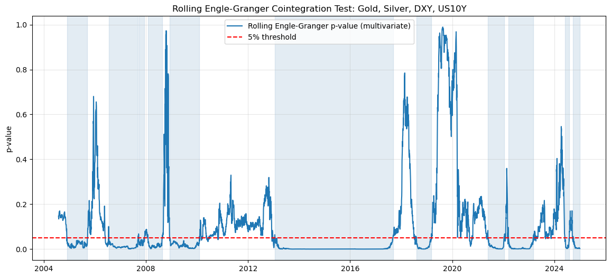
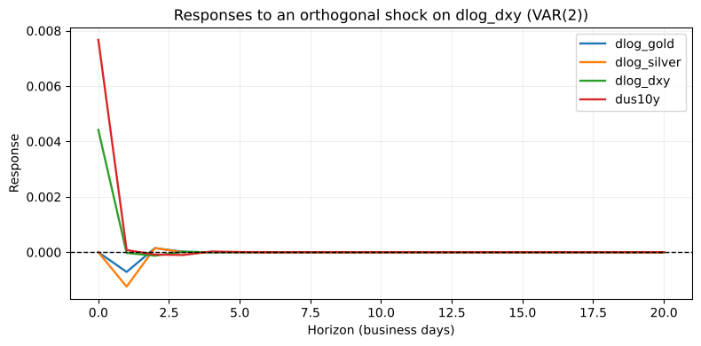

[English](README.md) | **Français**

# L'or et l'argent bougent-ils vraiment ensemble ? Seulement par moments.

Vingt-quatre ans de données journalières (2000-2024), des tests de cointégration, des modèles VAR/VECM et des fonctions de réponse impulsionnelle, pour tester une idée reçue du marché au lieu de la tenir pour acquise.

## En 30 secondes

- **L'or et l'argent sont très liés au jour le jour** (corrélation des résidus de 0,78), mais ce lien est presque entièrement instantané : aucun des deux métaux n'aide à prévoir le mouvement suivant de l'autre.
- **Il n'existe pas d'équilibre de long terme stable entre les deux métaux.** Seuls, un test glissant ne trouve qu'un épisode de cointégration en 24 ans : de mai 2015 à février 2016.
- **Ajouter l'indice dollar et le taux américain à 10 ans change le tableau.** Le test glissant trouve alors 11 épisodes qui couvrent environ la moitié de la période, mais le test de Johansen ne confirme toujours pas de relation sur l'ensemble de l'échantillon.
- **Quand les deux métaux sont cointégrés, c'est l'or qui mène.** Un choc sur l'or est absorbé comme un changement permanent des deux prix, alors qu'environ les trois quarts d'un choc sur l'argent se résorbent en 50 à 60 jours.

Pour la gestion des risques, la leçon est simple : une relation qui paraît stable sur une fenêtre peut se rompre sans prévenir. Une couverture ou une position de spread calibrée sur l'or et l'argent doit donc être surveillée, pas supposée.

## L'histoire

### 1. L'idée de départ

La plupart des investisseurs rangent l'or et l'argent dans la même case : métaux précieux, valeurs refuges, censés évoluer ensemble. Si c'était vrai au sens économétrique strict, leurs prix seraient **cointégrés** : ils pourraient s'écarter pendant un temps, mais un mécanisme de correction les ramènerait toujours vers un équilibre commun.

### 2. Premier test : l'idée ne tient pas

Les deux log-prix sont non stationnaires et leurs rendements sont stationnaires (ADF et KPSS concordent), donc un test de cointégration a du sens. Sur l'échantillon d'apprentissage (2000-2017) :

- Engle-Granger ne rejette pas l'absence de cointégration (p = 0,26) ;
- Johansen ne la rejette pas non plus, dans aucune des 6 spécifications testées ;
- les données mensuelles donnent la même réponse (0 détection sur 18 tests).

### 3. En regardant de plus près : le lien existe, mais par épisodes

Un seul test sur 17 ans peut masquer une relation qui ne tient qu'à certains moments. Un test d'Engle-Granger glissant (fenêtre de 1 000 jours) montre exactement cela : la p-value ne reste durablement sous 5 % qu'une seule fois, du **5 mai 2015 au 12 février 2016**, pendant la période de tension sur les matières premières.



Sur cette fenêtre, un VECM local donne une relation de long terme proche de un pour un (β = -0,89 sur l'argent) et un ajustement asymétrique : l'argent corrige l'écart (α = 0,13, p = 0,006), l'or ne le fait pas (α = 0,04, p = 0,14). L'or se comporte en meneur des prix, l'argent en suiveur.

Les fonctions de réponse impulsionnelle racontent la même chose : après un choc sur l'or, les deux métaux se stabilisent à un nouveau niveau permanent ; après un choc sur l'argent, l'essentiel du mouvement s'efface.



### 4. Ce qui les relie au jour le jour

Sur les rendements, le VAR(1) montre que le lien est simultané, pas séquentiel :

- pas de causalité de Granger, dans aucun sens (p = 0,52 et 0,37) ;
- une causalité instantanée très forte (statistique de Wald d'environ 2 309) ;
- des réponses impulsionnelles entièrement à l'impact, disparues dès le lendemain ;
- environ 61 % de la variance d'erreur de prévision de l'argent commune avec l'or.

Ré-estimer le VAR sur six régimes macro (pré-crise, crise financière, QE, tension sur les matières premières, fin de cycle, Covid) confirme qu'il n'y a d'effet retardé durable entre les deux métaux dans aucun d'eux.

### 5. L'hypothèse : des facteurs macro communs

Les deux métaux sont cotés en dollars et ne rapportent aucun rendement. Un dollar plus fort ou des taux réels plus élevés devraient peser sur les deux. Si ces facteurs communs sont omis, la relation or-argent peut paraître instable simplement parce qu'il manque quelque chose d'important. L'indice dollar (DXY) et le taux américain à 10 ans sont donc ajoutés au système.

### 6. Avec les facteurs macro : plus d'indices, toujours pas de certitude

- Engle-Granger rejette désormais l'absence de cointégration (ADF = -4,03, p = 0,001) ; Johansen toujours pas.
- Le test glissant trouve **11 épisodes** au lieu d'un, qui couvrent environ la moitié de la période. Le plus long va de janvier 2013 à septembre 2017 (1 165 observations).



Sur cette fenêtre 2013-2017, les deux métaux s'ajustent maintenant à l'équilibre (α de l'or = 0,013, α de l'argent = 0,031), et les réponses impulsionnelles généralisées montrent l'or qui baisse après un choc sur le dollar, l'argent réagissant environ 1,4 fois plus.

Deux réserves sont énoncées plutôt que cachées : le test glissant multivarié utilise des valeurs critiques génériques, qui rejettent plus facilement, et ajouter des régresseurs rend mécaniquement un résidu plus stationnaire en apparence. Le modèle 2013-2017 décrit un épisode de façon exploratoire, il ne prouve pas une relation structurelle.

### 7. Ce qui fait bouger l'or : le dollar, surtout le jour même

Dans le VAR(2) à quatre variables, le dollar cause l'or au sens de Granger à tous les retards de 1 à 100, et le taux à 10 ans jusqu'au retard 83. Mais les effets retardés sont faibles : le lendemain d'un choc, l'or baisse de 0,07 % (dollar) et de 0,05 % (taux), contre 1,08 % pour son propre choc. L'essentiel du lien dollar-or se joue dans la journée (corrélation des résidus de -0,40).



### 8. Un mot sur la prévision

Les modèles VAR atteignent un MAPE à un pas d'environ 0,7 % pour l'or et 1,4 % pour l'argent sur l'échantillon de test. Cela reflète surtout le fait que les prix journaliers sont proches d'une marche aléatoire : chaque prévision part du prix réel de la veille. Cela montre que les modèles sont stables hors échantillon, pas que l'or ou l'argent sont prévisibles.

## Structure du dépôt

```text
.
|-- data/                                   Données brutes et transformées (or, argent, variables macro)
|-- figures/                                Figures produites par les notebooks
|-- notebooks/
|   |-- 01_Data_Exploration.ipynb           Données, imputation, statistiques descriptives
|   |-- 02_Stationarity_and_Cointegration.ipynb
|   |                                       ADF/KPSS, Engle-Granger, Johansen, tests glissants
|   |-- 03_Bivariate_VAR_VECM.ipynb         VAR(1) sur les rendements, VECM local 2015-2016
|   |-- 04_Multivariate_VAR_VECM.ipynb      VAR(2) et VECM local 2013-2017 avec DXY et US10Y
|   `-- 05_Impulse_Response.ipynb           Causalité, IRF, FEVD, GIRF, robustesse par régime
|-- report/                                 Rapport d'origine du projet (en français)
`-- src/
    |-- cointegration.py                    Tests de cointégration
    |-- data_loader.py                      Téléchargement des données (yfinance)
    |-- plots.py                            Fonctions de visualisation
    |-- preprocessing.py                    Nettoyage, transformations, découpage train/val/test
    |-- stationarity.py                     Tests de stationnarité
    |-- utils.py                            Utilitaires (détection des épisodes de cointégration)
    `-- var_vecm.py                         Estimation VAR/VECM, causalité, IRF, FEVD, GIRF
```

## Méthodes

| Étape | Outils |
|---|---|
| Ordre d'intégration | ADF et KPSS, en niveau et en différences premières |
| Relation de long terme | Engle-Granger, Johansen (6 spécifications), sous-périodes, fenêtre glissante de 1 000 jours, robustesse mensuelle |
| Dynamique de court terme | VAR sur les rendements, choix du retard par critères d'information, tests LR et MAPE hors échantillon |
| Équilibre local | VECM sur les seuls épisodes de cointégration |
| Transmission des chocs | Causalité de Granger (balayage des retards de 1 à 100), causalité instantanée, IRF et FEVD de Cholesky, IRF généralisées (Pesaran et Shin, 1998) |

Les données sont journalières, du 30 août 2000 au 30 décembre 2024, découpées en 70/15/15 entre apprentissage, validation et test.

## Reproduire

```bash
git clone https://github.com/dalalbensalah/gold-silver-cointegration-analysis.git
cd gold-silver-cointegration-analysis
pip install -r requirements.txt
jupyter notebook
```

Lancer les notebooks dans l'ordre, de 01 à 05. Les données sont téléchargées depuis Yahoo Finance, qui révise parfois les prix passés : les résultats peuvent donc légèrement différer des chiffres ci-dessus.

## Différences avec le rapport d'origine

Ce dépôt est une version retravaillée d'un projet de master. Relancer toute l'analyse sur des données retéléchargées, et relire le code d'origine, a modifié certains résultats :

| Point | Rapport d'origine | Ce dépôt |
|---|---|---|
| VECM multivarié 2013-2017, relation de long terme | argent 0,78, dollar faiblement significatif (p = 0,067) | argent 0,88 en valeur absolue, dollar non significatif (p = 0,18) |
| Causalité de Granger, taux vers or | rejet jusqu'au retard 75 | rejet jusqu'au retard 83, limite au-delà |
| Test glissant, or et argent seuls | épisodes en 2015-2016 et autour du Covid | un seul épisode, 2015-2016 |
| Johansen mensuel, régime Covid | 1 spécification sur 6 | non testable (35 mois, sous les 36 requis) |
| VECM local 2015-2016, choc sur l'argent | IRF orthogonalisée, réponses négatives à long terme | IRF généralisée, réponses positives à long terme |
| GIRF multivariées | estimées sur l'échantillon complet | estimées sur l'épisode 2013-2017 |

Une erreur de code a aussi été corrigée : le test de causalité taux vers or du code d'origine portait en réalité sur le dollar.

## Limites et pistes

- La relation dépend du régime : un modèle à changement de régime markovien ou une cointégration à seuil décrirait directement les passages entre convergence et divergence, au lieu de les détecter fenêtre par fenêtre.
- Les réponses impulsionnelles sont des estimations ponctuelles ; des intervalles de confiance par bootstrap montreraient quels effets se distinguent statistiquement de zéro.
- D'autres facteurs communs (anticipations d'inflation, taux réels, VIX) et des données de positionnement (Commitments of Traders de la CFTC) pourraient expliquer quand les épisodes commencent et s'arrêtent.

## Références

### Or et argent

- Bampinas, G. and Panagiotidis, T. (2015). *Are Gold and Silver a Hedge against Inflation? A Two Century Perspective*. Discussion Paper No. 3/2015, University of Macedonia.
- Baur, D. G. and Lucey, B. M. (2010). Is Gold a Hedge or a Safe Haven? An Analysis of Stocks, Bonds and Gold. *Financial Review*, 45(2), 217-229. [doi:10.1111/j.1540-6288.2010.00244.x](https://doi.org/10.1111/j.1540-6288.2010.00244.x)
- Baur, D. G. and Tran, D. T. (2012). *The Long-run Relationship of Gold and Silver and the Influence of Bubbles and Financial Crises*. Working paper, University of Technology Sydney.
- Caporale, G. M. and Gil-Alana, L. A. (2022). *Gold and Silver as Safe Havens: A Fractional Integration and Cointegration Analysis*. CESifo Working Paper No. 10084.
- Ciner, C. (2001). On the Long Run Relationship between Gold and Silver Prices: A Note. *Global Finance Journal*, 12(2), 299-303. [doi:10.1016/S1044-0283(01)00034-5](https://doi.org/10.1016/S1044-0283(01)00034-5)
- Escribano, A. and Granger, C. W. J. (1998). Investigating the Relationship between Gold and Silver Prices. *Journal of Forecasting*, 17(2), 81-107.
- Fisher, I. (1930). *The Theory of Interest*. New York: Macmillan.
- Lucey, B. M. and Tully, E. (2006). The Evolving Relationship between Gold and Silver 1978-2002: Evidence from a Dynamic Cointegration Analysis. *Applied Financial Economics Letters*, 2(1), 47-53.
- Shrydeh, N., Shahateet, M., Mohammad, S. and Sumadi, M. (2019). The Hedging Effectiveness of Gold against US Stocks in a Post-Financial Crisis Era. *Cogent Economics & Finance*, 7(1), 1698268. [doi:10.1080/23322039.2019.1698268](https://doi.org/10.1080/23322039.2019.1698268)
- Wahab, M., Cohn, R. and Lashgari, M. (1994). The Gold-Silver Spread: Integration, Cointegration, Predictability, and Ex-ante Arbitrage. *Journal of Futures Markets*, 14(6), 709-756.

### Méthodes économétriques

- Balke, N. S. and Fomby, T. B. (1997). Threshold Cointegration. *International Economic Review*, 38(3), 627-645. [doi:10.2307/2527284](https://doi.org/10.2307/2527284)
- Dickey, D. A. and Fuller, W. A. (1979). Distribution of the Estimators for Autoregressive Time Series with a Unit Root. *Journal of the American Statistical Association*, 74(366), 427-431. [doi:10.1080/01621459.1979.10482531](https://doi.org/10.1080/01621459.1979.10482531)
- Engle, R. F. and Granger, C. W. J. (1987). Co-Integration and Error Correction: Representation, Estimation, and Testing. *Econometrica*, 55(2), 251-276. [doi:10.2307/1913236](https://doi.org/10.2307/1913236)
- Gonzalo, J. and Pitarakis, J.-Y. (2006). Threshold Effects in Cointegrating Relationships. *Oxford Bulletin of Economics and Statistics*, 68(s1), 813-833. [doi:10.1111/j.1468-0084.2006.00458.x](https://doi.org/10.1111/j.1468-0084.2006.00458.x)
- Granger, C. W. J. (1969). Investigating Causal Relations by Econometric Models and Cross-spectral Methods. *Econometrica*, 37(3), 424-438. [doi:10.2307/1912791](https://doi.org/10.2307/1912791)
- Gregory, A. W. and Hansen, B. E. (1996). Residual-based Tests for Cointegration in Models with Regime Shifts. *Journal of Econometrics*, 70(1), 99-126. [doi:10.1016/0304-4076(69)41685-7](https://doi.org/10.1016/0304-4076(69)41685-7)
- Hansen, H. and Johansen, S. (1999). Some Tests for Parameter Constancy in Cointegrated VAR-models. *Econometrics Journal*, 2(2), 306-333. [doi:10.1111/1368-423X.00035](https://doi.org/10.1111/1368-423X.00035)
- Johansen, S. (1991). Estimation and Hypothesis Testing of Cointegration Vectors in Gaussian Vector Autoregressive Models. *Econometrica*, 59(6), 1551-1580. [doi:10.2307/2938278](https://doi.org/10.2307/2938278)
- Kwiatkowski, D., Phillips, P. C. B., Schmidt, P. and Shin, Y. (1992). Testing the Null Hypothesis of Stationarity against the Alternative of a Unit Root. *Journal of Econometrics*, 54(1-3), 159-178. [doi:10.1016/0304-4076(92)90104-Y](https://doi.org/10.1016/0304-4076(92)90104-Y)
- Pesaran, H. H. and Shin, Y. (1998). Generalized Impulse Response Analysis in Linear Multivariate Models. *Economics Letters*, 58(1), 17-29. [doi:10.1016/S0165-1765(97)00214-0](https://doi.org/10.1016/S0165-1765(97)00214-0)

## Crédits

Autrice : Dalal Ben Salah.

**Projet d'origine.** Ce dépôt s'appuie sur un projet fait dans le cadre du master MBFA Gestion des Actifs et Modélisation des Risques de l'Université Paris Nanterre, réalisé avec Ilo Rakoto. Le travail a été partagé, mais dans les grandes lignes, Dalal Ben Salah a pris en charge l'analyse de cointégration (bivariée et multivariée), le VECM bivarié ainsi que le VAR et le VECM multivariés, et Ilo Rakoto la préparation des données et le VAR bivarié. Le rapport a été rédigé à deux, avec la mise en page LaTeX par Ilo Rakoto.

**Cette version.** Retravaillée par Dalal Ben Salah : nouvelle exécution complète sur des données téléchargées à nouveau, relecture du code d'origine et correction d'un test de causalité lancé sur la mauvaise variable, réécriture des notebooks et des modules `src/`, passage aux réponses impulsionnelles généralisées, GIRF multivariées réestimées sur l'épisode 2013-2017, et rédaction de ce README bilingue.

Python, pandas, numpy, statsmodels, matplotlib, yfinance.
