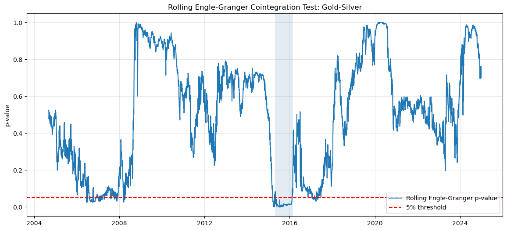
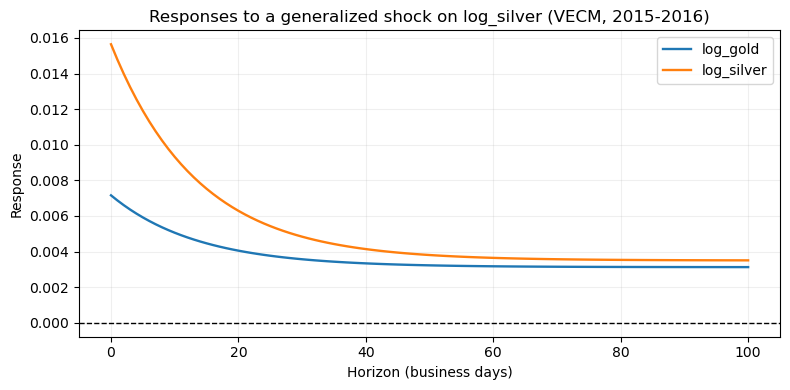
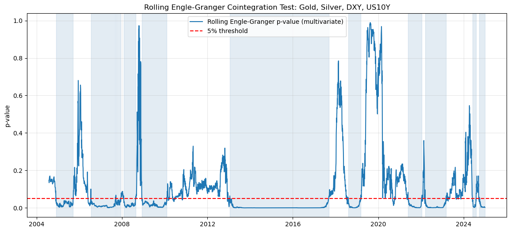
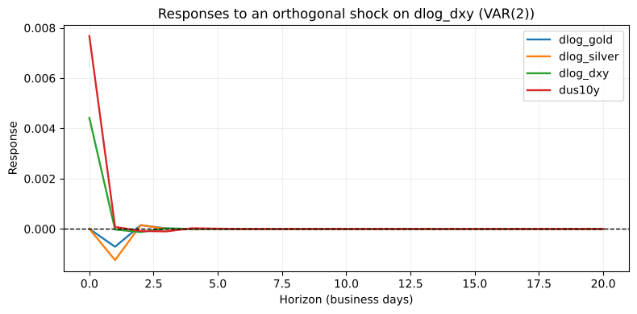

**English** | [Français](README.fr.md)

# Do gold and silver really move together? Only some of the time.

Twenty-four years of daily data (2000-2024), cointegration tests, VAR/VECM models and impulse responses, used to test a market belief instead of taking it for granted.

## In 30 seconds

- **Gold and silver are tightly linked day to day** (residual correlation of 0.78), but that link is almost entirely same-day: neither metal helps predict the other's next move.
- **There is no stable long-run equilibrium between the two metals.** On their own, a rolling test finds a single cointegration episode in 24 years: May 2015 to February 2016.
- **Adding the US dollar index and the 10-year Treasury yield changes the picture.** The rolling test then finds 11 episodes covering about half of the period, but the Johansen test still does not confirm a relation over the full sample.
- **When the two metals are cointegrated, gold leads.** A gold shock is absorbed as a permanent change in both prices, while about three quarters of a silver shock is reversed within 50 to 60 days.

For risk management, the lesson is simple: a relationship that looks stable on one window can break without warning, so a hedge or a spread position calibrated on gold and silver needs to be monitored, not assumed.

## The story

### 1. The starting belief

Gold and silver sit in the same box for most investors: precious metals, safe havens, supposed to move together. If that were true in the strict econometric sense, their prices would be **cointegrated**: they could drift apart for a while, but a correction mechanism would always pull them back toward a common equilibrium.

### 2. First test: the belief does not hold

Both log-prices are non-stationary and their returns are stationary (ADF and KPSS agree), so a cointegration test makes sense. On the training sample (2000-2017):

- Engle-Granger does not reject the absence of cointegration (p = 0.26);
- Johansen does not reject it either, in any of the 6 specifications tested;
- monthly data give the same answer (0 detection out of 18 tests).

### 3. A closer look: the link exists, but only in episodes

A single test over 17 years can hide a relation that only holds at certain times. A rolling Engle-Granger test (1,000-day window) shows exactly that: the p-value only stays below 5% for one sustained episode, from **5 May 2015 to 12 February 2016**, during the commodity stress period.



On that window, a local VECM gives a long-run relation close to one for one (β = -0.89 on silver) and an asymmetric adjustment: silver corrects the gap (α = 0.13, p = 0.006), gold does not (α = 0.04, p = 0.14). Gold behaves as the price leader, silver as the follower.

The impulse responses tell the same story: after a gold shock, both metals settle at a new permanent level; after a silver shock, most of the move fades away.



### 4. What links them day to day

On returns, the VAR(1) shows that the connection is contemporaneous, not sequential:

- no Granger causality in either direction (p = 0.52 and 0.37);
- very strong instantaneous causality (Wald statistic of about 2,309);
- impulse responses that are entirely on impact and gone the next day;
- about 61% of silver's forecast error variance shared with gold.

Re-estimating the VAR on six macro regimes (pre-crisis, financial crisis, QE, commodity stress, late cycle, Covid) confirms that there is no lasting lagged effect between the two metals in any of them.

### 5. The hypothesis: common macro factors

Both metals are priced in dollars and pay no yield. A stronger dollar or higher real rates should weigh on both. If these common factors are left out, the gold-silver relation can look unstable simply because something important is missing. So the US dollar index (DXY) and the 10-year Treasury yield are added to the system.

### 6. With the macro factors: more evidence, still no certainty

- Engle-Granger now rejects the absence of cointegration (ADF = -4.03, p = 0.001); Johansen still does not.
- The rolling test finds **11 episodes** instead of one, covering about half of the period. The longest runs from January 2013 to September 2017 (1,165 observations).



On that 2013-2017 window, both metals now adjust to the equilibrium (gold α = 0.013, silver α = 0.031), and the generalized impulse responses show gold falling after a dollar shock, with silver reacting about 1.4 times more.

Two caveats are stated rather than hidden: the multivariate rolling test uses generic critical values, which reject more easily, and adding regressors mechanically makes a residual look more stationary. The 2013-2017 model is an exploratory description of an episode, not proof of a structural relation.

### 7. What moves gold: the dollar, mostly on the same day

In the four-variable VAR(2), the dollar Granger-causes gold at every lag order from 1 to 100, and the 10-year yield up to lag 83. But the lagged effects are small: the day after a shock, gold falls by 0.07% (dollar) and 0.05% (rates), against 1.08% for its own shock. Most of the dollar-gold link happens within the day (residual correlation of -0.40).



### 8. A word on forecasting

The VAR models reach a one-step-ahead MAPE of about 0.7% for gold and 1.4% for silver on the test sample. This mainly reflects the fact that daily prices are close to a random walk: each forecast starts from yesterday's actual price. It shows that the models are stable out of sample, not that gold or silver can be predicted.

## Repository structure

```text
.
|-- data/                                   Raw and processed data (gold, silver, macro variables)
|-- figures/                                Figures generated by the notebooks
|-- notebooks/
|   |-- 01_Data_Exploration.ipynb           Data, imputation, descriptive statistics
|   |-- 02_Stationarity_and_Cointegration.ipynb
|   |                                       ADF/KPSS, Engle-Granger, Johansen, rolling tests
|   |-- 03_Bivariate_VAR_VECM.ipynb         VAR(1) on returns, local VECM 2015-2016
|   |-- 04_Multivariate_VAR_VECM.ipynb      VAR(2) and local VECM 2013-2017 with DXY and US10Y
|   `-- 05_Impulse_Response.ipynb           Causality, IRF, FEVD, GIRF, robustness by regime
|-- report/                                 Original project report (French)
`-- src/
    |-- cointegration.py                    Cointegration tests
    |-- data_loader.py                      Data download (yfinance)
    |-- plots.py                            Plotting functions
    |-- preprocessing.py                    Cleaning, transformations, train/val/test split
    |-- stationarity.py                     Stationarity tests
    |-- utils.py                            Helpers (detection of cointegration episodes)
    `-- var_vecm.py                         VAR/VECM estimation, causality, IRF, FEVD, GIRF
```

## Methods

| Step | Tools |
|---|---|
| Order of integration | ADF and KPSS, in levels and first differences |
| Long-run relation | Engle-Granger, Johansen (6 specifications), sub-periods, rolling window of 1,000 days, monthly robustness |
| Short-run dynamics | VAR on returns, lag choice by information criteria, LR tests and out-of-sample MAPE |
| Local equilibrium | VECM on the cointegration episodes only |
| Transmission of shocks | Granger causality (lag sweep from 1 to 100), instantaneous causality, Cholesky IRF and FEVD, generalized IRF (Pesaran and Shin, 1998) |

Data are daily, from 30 August 2000 to 30 December 2024, split 70/15/15 into training, validation and test samples.

## Reproduce

```bash
git clone https://github.com/dalalbensalah/gold-silver-cointegration-analysis.git
cd gold-silver-cointegration-analysis
pip install -r requirements.txt
jupyter notebook
```

Run the notebooks in order, from 01 to 05. Data are downloaded from Yahoo Finance, which occasionally revises past prices, so results can differ slightly from the figures above.

## Differences from the original report

This repository is a reworked version of a Master's project. Re-running the full analysis on freshly downloaded data, and reviewing the original code, changed some results:

| Point | Original report | This repository |
|---|---|---|
| Multivariate VECM 2013-2017, long-run relation | silver 0.78, dollar marginally significant (p = 0.067) | silver 0.88 in absolute value, dollar not significant (p = 0.18) |
| Granger causality, rates to gold | rejected up to lag 75 | rejected up to lag 83, borderline beyond |
| Rolling test, gold and silver alone | episodes in 2015-2016 and around Covid | a single episode, 2015-2016 |
| Monthly Johansen test, Covid regime | 1 specification out of 6 | not testable (35 months, below the 36 required) |
| Local VECM 2015-2016, silver shock | orthogonalized IRF, negative long-run responses | generalized IRF, positive long-run responses |
| Multivariate GIRF | estimated on the full sample | estimated on the 2013-2017 episode |

One coding error was also corrected: the rates-to-gold causality test of the original code was in fact run on the dollar.

## Limits and next steps

- The relation is regime-dependent: a Markov-switching or threshold cointegration model would describe the switches between convergence and divergence directly instead of detecting them window by window.
- Impulse responses are point estimates; bootstrap confidence bands would show which effects are statistically distinguishable from zero.
- Other common factors (inflation expectations, real rates, VIX) and positioning data (CFTC Commitments of Traders) could explain when the episodes start and end.

## References

### Gold and silver

- Bampinas, G. and Panagiotidis, T. (2015). *Are Gold and Silver a Hedge against Inflation? A Two Century Perspective*. Discussion Paper No. 3/2015, University of Macedonia.
- Baur, D. G. and Lucey, B. M. (2010). Is Gold a Hedge or a Safe Haven? An Analysis of Stocks, Bonds and Gold. *Financial Review*, 45(2), 217-229. [doi:10.1111/j.1540-6288.2010.00244.x](https://doi.org/10.1111/j.1540-6288.2010.00244.x)
- Baur, D. G. and Tran, D. T. (2012). *The Long-run Relationship of Gold and Silver and the Influence of Bubbles and Financial Crises*. Working paper, University of Technology Sydney.
- Caporale, G. M. and Gil-Alana, L. A. (2022). *Gold and Silver as Safe Havens: A Fractional Integration and Cointegration Analysis*. CESifo Working Paper No. 10084.
- Ciner, C. (2001). On the Long Run Relationship between Gold and Silver Prices: A Note. *Global Finance Journal*, 12(2), 299-303. [doi:10.1016/S1044-0283(01)00034-5](https://doi.org/10.1016/S1044-0283(01)00034-5)
- Escribano, A. and Granger, C. W. J. (1998). Investigating the Relationship between Gold and Silver Prices. *Journal of Forecasting*, 17(2), 81-107.
- Fisher, I. (1930). *The Theory of Interest*. New York: Macmillan.
- Lucey, B. M. and Tully, E. (2006). The Evolving Relationship between Gold and Silver 1978-2002: Evidence from a Dynamic Cointegration Analysis. *Applied Financial Economics Letters*, 2(1), 47-53.
- Shrydeh, N., Shahateet, M., Mohammad, S. and Sumadi, M. (2019). The Hedging Effectiveness of Gold against US Stocks in a Post-Financial Crisis Era. *Cogent Economics & Finance*, 7(1), 1698268. [doi:10.1080/23322039.2019.1698268](https://doi.org/10.1080/23322039.2019.1698268)
- Wahab, M., Cohn, R. and Lashgari, M. (1994). The Gold-Silver Spread: Integration, Cointegration, Predictability, and Ex-ante Arbitrage. *Journal of Futures Markets*, 14(6), 709-756.

### Econometric methods

- Balke, N. S. and Fomby, T. B. (1997). Threshold Cointegration. *International Economic Review*, 38(3), 627-645. [doi:10.2307/2527284](https://doi.org/10.2307/2527284)
- Dickey, D. A. and Fuller, W. A. (1979). Distribution of the Estimators for Autoregressive Time Series with a Unit Root. *Journal of the American Statistical Association*, 74(366), 427-431. [doi:10.1080/01621459.1979.10482531](https://doi.org/10.1080/01621459.1979.10482531)
- Engle, R. F. and Granger, C. W. J. (1987). Co-Integration and Error Correction: Representation, Estimation, and Testing. *Econometrica*, 55(2), 251-276. [doi:10.2307/1913236](https://doi.org/10.2307/1913236)
- Gonzalo, J. and Pitarakis, J.-Y. (2006). Threshold Effects in Cointegrating Relationships. *Oxford Bulletin of Economics and Statistics*, 68(s1), 813-833. [doi:10.1111/j.1468-0084.2006.00458.x](https://doi.org/10.1111/j.1468-0084.2006.00458.x)
- Granger, C. W. J. (1969). Investigating Causal Relations by Econometric Models and Cross-spectral Methods. *Econometrica*, 37(3), 424-438. [doi:10.2307/1912791](https://doi.org/10.2307/1912791)
- Gregory, A. W. and Hansen, B. E. (1996). Residual-based Tests for Cointegration in Models with Regime Shifts. *Journal of Econometrics*, 70(1), 99-126. [doi:10.1016/0304-4076(69)41685-7](https://doi.org/10.1016/0304-4076(69)41685-7)
- Hansen, H. and Johansen, S. (1999). Some Tests for Parameter Constancy in Cointegrated VAR-models. *Econometrics Journal*, 2(2), 306-333. [doi:10.1111/1368-423X.00035](https://doi.org/10.1111/1368-423X.00035)
- Johansen, S. (1991). Estimation and Hypothesis Testing of Cointegration Vectors in Gaussian Vector Autoregressive Models. *Econometrica*, 59(6), 1551-1580. [doi:10.2307/2938278](https://doi.org/10.2307/2938278)
- Kwiatkowski, D., Phillips, P. C. B., Schmidt, P. and Shin, Y. (1992). Testing the Null Hypothesis of Stationarity against the Alternative of a Unit Root. *Journal of Econometrics*, 54(1-3), 159-178. [doi:10.1016/0304-4076(92)90104-Y](https://doi.org/10.1016/0304-4076(92)90104-Y)
- Pesaran, H. H. and Shin, Y. (1998). Generalized Impulse Response Analysis in Linear Multivariate Models. *Economics Letters*, 58(1), 17-29. [doi:10.1016/S0165-1765(97)00214-0](https://doi.org/10.1016/S0165-1765(97)00214-0)

## Credits

Author: Dalal Ben Salah.

**Original project.** This repository builds on a project for the MBFA Master's programme in Asset Management and Risk Modelling at Université Paris Nanterre, carried out with Ilo Rakoto. The work was shared, but broadly: Dalal Ben Salah handled the cointegration analysis (bivariate and multivariate), the bivariate VECM and the multivariate VAR and VECM; Ilo Rakoto handled the data preparation and the bivariate VAR. The report was written together, with the LaTeX layout by Ilo Rakoto.

**This version.** Reworked by Dalal Ben Salah: full re-run on freshly downloaded data, review of the original code and correction of a causality test run on the wrong variable, rewritten notebooks and `src/` modules, generalized impulse responses, multivariate GIRF re-estimated on the 2013-2017 episode, and this bilingual README.

Python, pandas, numpy, statsmodels, matplotlib, yfinance.
